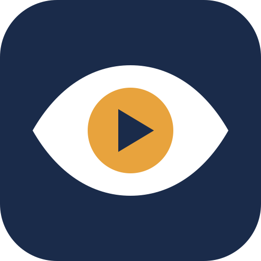

<p align="center">
  
</p>

# Couch Owl

A self-hosted watchlist for movies and TV shows, for you and the people you invite.

> **Status:** heading for 1.0 – all planned features are in place, the first release
> candidate is being prepared. See [docs/ROADMAP.md](docs/ROADMAP.md).

## Features

- Your own private lists ("My watchlist", "Watch with family", …) with movies and shows
  mixed, filled via the built-in search; grid or compact view, filters for watched and type
- Batch import: paste the titles from another app or a spreadsheet, check the matches,
  done
- Track TV shows episode by episode or mark whole seasons as watched, with the date you
  watched them
- Dashboard with the next episode of every show you are watching, one click to mark it
- Follow shows and see announcements of new seasons, an "Upcoming" page and where
  each title streams in your country
- TMDB ratings in search, lists and on detail pages
- Invite-only accounts; interface in English and German, picked from your country
- Privacy-friendly: no CDNs, no tracking, your browser never talks to third parties
  (Couch Owl fetches data and posters from TMDB itself)
- Installable on your phone (PWA); runs as a single small Docker container with SQLite
  (PostgreSQL optional), daily data refresh and nightly database copies built in

## Installation

```sh
git clone https://github.com/okoetter/couchowl.git && cd couchowl
cp .env.example .env    # then edit: SECRET_KEY, SITE_URL, TMDB_API_TOKEN, …
docker compose up -d --build
docker compose exec couchowl python manage.py createsuperuser
```

Then open <http://localhost:8000>. You need a free [TMDB](https://www.themoviedb.org/)
API token.

## Documentation

- [docs/deployment.md](docs/deployment.md): installation, reverse proxy and HTTPS, updates
- [docs/administration.md](docs/administration.md): inviting users, password resets,
  e-mail, TMDB sync, backups and restore
- [.env.example](.env.example): all settings
- [CHANGELOG.md](CHANGELOG.md): what changed in each version
- [docs/design.md](docs/design.md): design decisions and their reasons
- [docs/ROADMAP.md](docs/ROADMAP.md): plans and backlog

## Development

See [CONTRIBUTING.md](CONTRIBUTING.md).

## License

Couch Owl is free software under the
[GNU Affero General Public License v3.0 or later](LICENSE). If you run a modified version
for other people, you must offer them its source code (set `SOURCE_URL` to point the
About page there).

## Credits

This product uses the TMDB API but is not endorsed or certified by TMDB.
Movie and show data and posters come from [The Movie Database (TMDB)](https://www.themoviedb.org/),
streaming provider data from [JustWatch](https://www.justwatch.com/).

Couch Owl is built with [Django](https://www.djangoproject.com/), [htmx](https://htmx.org/),
[Alpine.js](https://alpinejs.dev/) and [Pico CSS](https://picocss.com/).
